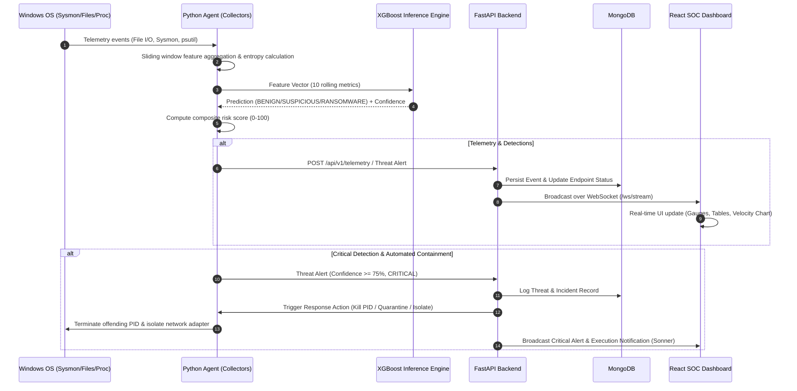
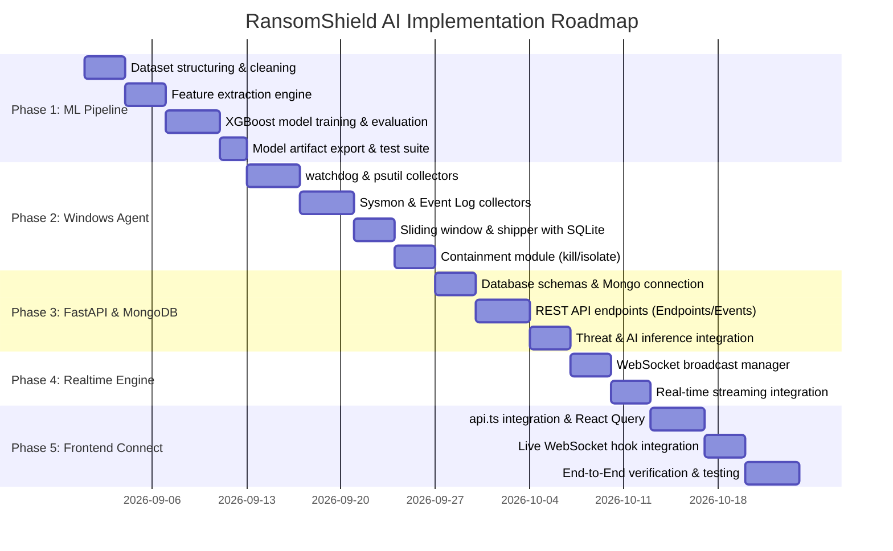

# RansomShield AI — End-to-End Architecture Specification

**Project:** RansomShield AI  
**Tagline:** AI-Powered Real-Time Behavioral Ransomware Detection and Automated Response for Small and Medium Enterprises (SMEs)  
**Document Version:** 1.0.0  
**Status:** Architectural Blueprint & Implementation Specification  

---

## 1. Executive Summary & System Overview

RansomShield AI is a hybrid behavioral detection and response platform designed to protect Windows endpoints from fast-acting ransomware threats. Traditional signature-based antivirus solutions struggle against zero-day variants and polymorphic ransomware payloads. RansomShield AI addresses this by analyzing behavioral telemetry (process execution patterns, rapid file modifications/renames, entropy surges, CPU spikes, and registry modifications) in real time using a trained **XGBoost machine learning model**.

The platform is designed with two strictly decoupled operational pipelines:
1. **Historical Training Pipeline (Offline):** Ingests static, labeled behavioral datasets, extracts features, performs hyperparameter optimization, evaluates metrics (Accuracy, Precision, Recall, F1, ROC-AUC), and exports versioned model artifacts (`xgb_ransomware_v1.json`).
2. **Live Detection Pipeline (Runtime):** Lightweight Python agents on Windows endpoints stream telemetry, extract rolling feature vectors, run inference against the loaded XGBoost model, calculate risk scores (0–100), and stream detections to a FastAPI/MongoDB backend and the React SOC Dashboard.

```
+----------------------------------------------------------------------------------------------------+
|                                      RANSOMSHIELD AI ARCHITECTURE                                  |
+----------------------------------------------------------------------------------------------------+

  [ Windows Endpoint ]
         |
         +--> Collectors: Sysmon | Windows Event Log | psutil | watchdog
         |
  [ Python Monitoring Agent ]
         |
         +--> Sliding Window Buffer (5s / 10s / 30s)
         |
         +--> Real-time Feature Extraction (Entropy, File Rates, Process Tree, CPU Spike)
         |
         +--> [ XGBoost Model Inference (Offline-Trained XGB-v1.0 Artifact) ]
         |
         +--> Risk Score Computation (0-100) & Early Warning State
         |
         +--> HTTPS / WebSocket Telemetry Shipper (Local SQLite Fallback Buffer)
         |
         v
  [ FastAPI Backend Engine ] <===============> [ MongoDB Database ]
         |                                      - endpoints, events, threats,
         +-- REST API (Endpoints, History,      - incidents, audit, metrics
         |             Policies, Config)
         |
         +-- WebSocket Manager (`/ws/stream`)
         |
         v
  [ React SOC Dashboard ] (TanStack Start / TanStack Router / TanStack Query / Tailwind CSS)
```

---

## 2. Current Architecture vs. Target Architecture

### 2.1 Current State (Frontend Prototype)
- **Framework:** React 19 + TanStack Start (SSR) + TanStack Router + Tailwind CSS v4 + TanStack React Query.
- **State & Simulation:** `src/lib/demo-context.tsx` and `src/lib/mock-data.ts` power an interactive, scripted simulation engine supporting `SAFE`, `WARNING`, and `CRITICAL` states.
- **Service Layer:** `src/services/api.ts` provides promisified mock resolvers designed with identical signatures to the future REST API.
- **Visualizations:** Recharts (file velocity, threat trends, severity distribution), custom SVG risk gauge, and telemetry feeds.
- **SOC Capabilities:** 12 dedicated views (Command Center, Live Monitoring, Endpoint Inventory & Details, Threats & Incident Investigation, Security Events Log, AI Detection & Model Health, Attack Replay, Executive Reports, System Architecture, Offline Training Data, and Settings).

### 2.2 Target End-to-End System
- **Endpoint Agent (`agent/`):** Python-based Windows service running non-blocking telemetry collectors (`psutil`, `watchdog`, `win32evtlog` for Sysmon and Event Logs) with local offline buffering in SQLite.
- **Machine Learning Core (`ml/`):** Offline feature extraction, XGBoost classifier training, SHAP explainability generation, and export to production model artifacts.
- **Backend Service (`backend/`):** FastAPI application with asynchronous Motor/MongoDB drivers, Pydantic v2 schemas, WebSocket pub/sub connection manager, background worker tasks, and automated response orchestration.
- **Database (`MongoDB`):** High-throughput collections for telemetry events, threat records, endpoint registries, audit logs, and aggregated metrics.
- **Connected Frontend:** React application toggled to `USE_REAL_API = true`, backed by TanStack Query for cache invalidation and WebSocket listeners for sub-second telemetry and alert streaming.

---

## 3. Data Flow Architecture



---

## 4. Pipeline Separation: Training vs. Live Detection

### 4.1 Historical Training Pipeline (`ml/`)
Runs **offline only**. It never ingests live runtime telemetry directly to retrain on the fly, ensuring deterministic, reproducible model behavior without catastrophic forgetting or poisoning attacks.

```
Historical Labeled Dataset (Raw PCAP/EVTX/CSV logs)
                       ↓
Data Cleaning (Deduplication, Imputation, Outlier Filtering)
                       ↓
Feature Engineering (Sliding window aggregations, Entropy, I/O rates)
                       ↓
Stratified Train/Test Split (80% Train / 20% Test)
                       ↓
XGBoost Classifier Training (Hyperparameter Tuning via Optuna / GridSearchCV)
                       ↓
Evaluation (Accuracy, Precision, Recall, F1-Score, ROC-AUC, Confusion Matrix)
                       ↓
Export Model Artifact (`xgb_ransomware_v1.json` + `feature_meta.json` + `scaler.pkl`)
```

### 4.2 Live Detection Pipeline (`agent/` + `backend/`)
Runs **continuously at runtime** on protected endpoints and backend servers.

```
Windows Endpoint Telemetry (Sysmon Event ID 1/11/12, watchdog File Events, psutil metrics)
                       ↓
Local Normalization & Sliding Window Buffer (5s, 10s, 30s)
                       ↓
Live Feature Extraction (Matches exact schema from `feature_meta.json`)
                       ↓
Model Inference (Loaded `xgb_ransomware_v1.json` artifact)
                       ↓
Prediction: BENIGN | SUSPICIOUS | RANSOMWARE (Probability Score: 0.00 – 1.00)
                       ↓
Risk Score Derivation: 0 – 100 & Early Warning State Mapping
                       ↓
Policy Evaluation:
  - 0–30 (LOW): Log telemetry, normal operation
  - 31–60 (MEDIUM): Raise warning, increase sampling rate
  - 61–80 (HIGH): Alert SOC administrator, capture forensic snapshot
  - 81–100 (CRITICAL): Auto-terminate PID, quarantine binary, isolate endpoint
                       ↓
Stream to FastAPI → Persist in MongoDB → Push via WebSocket to React Dashboard
```

---

## 5. Telemetry & Feature Engineering Specification

The feature engineering layer guarantees that feature vectors calculated during live endpoint monitoring are mathematically identical to those used during model training.

| # | Feature Name | Source | Sampling Window | Description |
|---|---|---|---|---|
| 1 | `file_mod_rate` | watchdog | 10 sec | Number of file modifications per second |
| 2 | `file_rename_rate` | watchdog / Sysmon | 10 sec | Number of file extension / path rename events per second |
| 3 | `file_delete_rate` | watchdog | 10 sec | Number of file deletion events per second |
| 4 | `write_entropy_avg` | watchdog / agent | Per-file (buffer) | Shannon entropy (\(0.0 - 8.0\)) of written byte chunks |
| 5 | `high_entropy_ratio` | watchdog | 10 sec | Ratio of file writes with Shannon entropy \(> 7.2\) |
| 6 | `cpu_usage_pct` | psutil | 5 sec | Mean CPU utilization percentage of the candidate process |
| 7 | `memory_usage_pct` | psutil | 5 sec | Memory utilization percentage of candidate process |
| 8 | `process_spawn_rate` | Sysmon Event 1 / psutil | 30 sec | Child process creation rate per minute |
| 9 | `unsigned_proc_ratio`| pywin32 / pefile | Snapshot | Proportion of running binaries lacking valid digital signatures |
| 10| `registry_write_rate`| Sysmon Event 13 | 10 sec | Modifications to Run keys, startup keys, or shadow copy configs |
| 11| `network_conn_rate`  | Sysmon Event 3 / psutil | 10 sec | Outbound TCP/UDP connection attempts per minute |
| 12| `shadow_copy_access` | Event Log (4688) | Snapshot | Binary flag indicating `vssadmin` or `wmic shadowcopy` invocation |

---

## 6. Frontend ↔ Backend Communication Layer

### 6.1 REST API Endpoint Mapping
The existing frontend service in `src/services/api.ts` maps directly to the target FastAPI routes:

| Frontend API Method | Target REST Endpoint | HTTP Verb | Description |
|---|---|---|---|
| `api.getStatus()` | `/api/v1/system/status` | `GET` | Overall health, active risk score, early warning state |
| `api.getHealthScore()` | `/api/v1/system/health` | `GET` | Breakdown of coverage, response readiness, software health |
| `api.getEndpoints()` | `/api/v1/endpoints` | `GET` | Inventory of all registered endpoints with telemetry |
| `api.getEndpoint(id)` | `/api/v1/endpoints/{id}` | `GET` | Deep dive into a specific workstation's status and telemetry |
| `api.getEvents()` | `/api/v1/events` | `GET` | Paginated and filtered security telemetry event stream |
| `api.getThreats()` | `/api/v1/threats` | `GET` | List of detected threats and incident classifications |
| `api.getThreat(id)` | `/api/v1/threats/{id}` | `GET` | Detailed threat record with attack timeline and evidence |
| `api.getAiPrediction()` | `/api/v1/ai/prediction` | `GET` | Live model verdict, feature attribution, and confidence |
| `api.getModelStatus()` | `/api/v1/ai/model-health` | `GET` | Version, accuracy, precision, recall, and prediction counts |
| `api.getMetrics()` | `/api/v1/reports/metrics` | `GET` | 30-day historical trend data for threats detected and blocked |
| *Response Action* | `/api/v1/response/execute` | `POST` | Execute containment action (Kill PID, Quarantine, Isolate) |
| *Settings* | `/api/v1/settings` | `GET` / `PUT` | Read and update detection thresholds and response policies |

### 6.2 WebSocket Streaming Contract (`/ws/stream`)
Real-time events pushed from FastAPI to the dashboard:
- `heartbeat`: Periodic ping containing system timestamp and agent connection status.
- `telemetry_sample`: Live CPU, memory, and file velocity points for charting.
- `event_logged`: New Sysmon/psutil/watchdog event added to the live stream.
- `threat_detected`: Instant notification when model triggers WARNING or CRITICAL verdict.
- `response_executed`: Containment confirmation message.

### 6.3 Transition Strategy in Frontend
1. Keep existing mock engine in `src/lib/mock-data.ts` completely intact.
2. In `src/services/api.ts`, implement fetch calls to `API_BASE_URL` with a fallback mechanism when the backend is unreachable.
3. Replace component-level direct mock function calls in routes (`index.tsx`, `monitoring.tsx`, `threats.index.tsx`, etc.) with TanStack Query hooks (`useQuery({ queryKey: [...], queryFn: ... })`).
4. Connect `subscribeToStream` to a native WebSocket client with exponential backoff reconnects.

---

## 7. Database Design (MongoDB Schemas)

### 7.1 Collection: `endpoints`
```json
{
  "_id": "ep-06",
  "name": "HR-PC-03",
  "user": "a.novak",
  "department": "HR",
  "os": "Windows 11 Pro 23H2",
  "agent_version": "1.0.0",
  "agent_status": "online",
  "last_heartbeat": "2026-08-29T16:14:30Z",
  "ip_address": "192.168.1.104",
  "mac_address": "00:1A:2B:3C:4D:5E",
  "resources": {
    "cpu": 61.2,
    "memory": 78.4,
    "disk": 42.1,
    "network": 66.0,
    "processes": 88
  },
  "behavior": {
    "file_activity": 62,
    "process_activity": 88,
    "network_activity": 64,
    "registry_activity": 71
  },
  "risk_score": 98,
  "severity": "critical",
  "created_at": "2026-08-01T00:00:00Z",
  "updated_at": "2026-08-29T16:14:30Z"
}
```
*Indexes:* `{ "name": 1 }` (unique), `{ "severity": 1 }`, `{ "last_heartbeat": -1 }`, `{ "risk_score": -1 }`.

### 7.2 Collection: `security_events`
```json
{
  "_id": "evt-948194",
  "timestamp": "2026-08-29T16:14:28Z",
  "endpoint_id": "ep-06",
  "endpoint_name": "HR-PC-03",
  "source": "watchdog",
  "event_type": "Mass File Modification",
  "process_name": "invoice_update.exe",
  "pid": 9184,
  "severity": "critical",
  "status": "Flagged",
  "detail": "1,248 files touched in 9 seconds; entropy 7.64",
  "metadata": {
    "path": "C:\\Users\\a.novak\\Downloads\\invoice_update.exe",
    "target_directory": "C:\\Users\\a.novak\\Documents",
    "entropy": 7.64
  }
}
```
*Indexes:* `{ "timestamp": -1 }`, `{ "endpoint_name": 1, "timestamp": -1 }`, `{ "severity": 1 }`, `{ "source": 1 }`.  
*TTL Index:* Optional 30-day retention on `timestamp`.

### 7.3 Collection: `threats`
```json
{
  "_id": "THR-0017",
  "endpoint_name": "HR-PC-03",
  "process_name": "invoice_update.exe",
  "pid": 9184,
  "type": "Ransomware",
  "severity": "critical",
  "confidence": 98.7,
  "stage": 6,
  "detected_at": "2026-08-29T16:14:29Z",
  "status": "Blocked",
  "summary": "Unsigned executable delivered via mail attachment initiated mass file modification and rename operations consistent with encryption.",
  "files_affected": 1248,
  "indicators": [
    { "label": "Rapid file modification", "weight": 94 },
    { "label": "Abnormal process behavior", "weight": 89 },
    { "label": "High file rename rate", "weight": 87 },
    { "label": "Unusual CPU activity", "weight": 72 },
    { "label": "Network anomaly", "weight": 51 }
  ],
  "timeline": [
    { "time": "10:42:39", "title": "Mail attachment opened", "detail": "invoice_update.zip extracted", "severity": "info" },
    { "time": "10:42:40", "title": "Suspicious executable launched", "detail": "PID 9184 spawned by OUTLOOK.EXE", "severity": "medium" },
    { "time": "10:42:43", "title": "AI classification: RANSOMWARE", "detail": "XGB-v1.0 confidence 98.7%", "severity": "critical" },
    { "time": "10:42:44", "title": "Process terminated", "detail": "Automated response: PID 9184 killed", "severity": "critical" }
  ]
}
```

### 7.4 Collection: `audit_logs`
```json
{
  "_id": "aud-00912",
  "timestamp": "2026-08-29T16:14:44Z",
  "actor": "System",
  "action": "Blocked Process (invoice_update.exe)",
  "endpoint": "HR-PC-03",
  "result": "Success",
  "detail": "Terminated PID 9184 following CRITICAL policy match"
}
```

---

## 8. Windows Telemetry Collection Architecture

The Windows Agent runs as a non-intrusive Python background service (`agent_daemon.py`) using multithreading to isolate collector bottlenecks.

```
+-------------------------------------------------------------------------+
|                       PYTHON MONITORING AGENT                           |
+-------------------------------------------------------------------------+
|                                                                         |
|  [ Collector Threads ]                                                  |
|  ├── Sysmon Collector (win32evtlog / EVTX channel 'Microsoft-Windows-   |
|  │                     Sysmon/Operational')                              |
|  │   - Event 1: Process Create (hashes, parent-child, command line)     |
|  │   - Event 3: Network Connection (IP, Port, Protocol)                 |
|  │   - Event 11: FileCreate (executable creation in temp/download dirs) |
|  │   - Event 13: RegistryValueSet (Run keys, safe mode tampering)       |
|  │                                                                      |
|  ├── watchdog Collector (FileSystemEventHandler)                        |
|  │   - Monitors User directories (Documents, Desktop, Downloads, Shared)|
|  │   - Computes modifications/sec, renames/sec, deletions/sec           |
|  │   - Samples first 4KB of modified files for Shannon Entropy          |
|  │                                                                      |
|  └── psutil Collector (5-second polling loop)                           |
|      - CPU% & Memory% per process                                       |
|      - System-wide I/O counters and network connection metrics          |
|                                                                         |
|  [ Sliding Window Buffer (In-Memory Queue) ]                            |
|      - Maintains rolling 5s, 10s, and 30s aggregate windows             |
|                                                                         |
|  [ Local Inference Engine (Optional Edge Mode) / Remote Shipper ]       |
|      - Formats standardized JSON telemetry payloads                     |
|      - Ships over HTTPS with local SQLite queue for network outages     |
|                                                                         |
|  [ Containment Executor ]                                               |
|      - Terminate Process (`psutil.Process(pid).kill()`)                 |
|      - File Quarantine (Move to encrypted staging folder)               |
|      - Network Isolation (`netsh advfirewall` rules / Windows WFP)      |
+-------------------------------------------------------------------------+
```

---

## 9. Security & Safety Considerations

1. **Safety Guards on Containment Actions:**
   - Whitelist essential Windows operating system binaries (`smss.exe`, `csrss.exe`, `wininit.exe`, `services.exe`, `lsass.exe`, `svchost.exe`, `explorer.exe`).
   - Terminate action verifies PID matching against the executable path and creation time before issuing kill signal to prevent PID reuse hazards.
2. **Agent-to-Server Authentication:**
   - Mutual TLS (mTLS) or HMAC-signed HTTP headers with rotating agent authentication tokens.
3. **Tamper Resistance:**
   - Python agent runs under `NT AUTHORITY\SYSTEM` service context with restricted directory permissions for the agent configuration and model artifacts.
4. **Data Privacy:**
   - Raw file contents are never transmitted. Only calculated metadata (Shannon entropy, file path hashes, extension changes, modification rates) leaves the endpoint.

---

## 10. Recommended Repository Structure

To integrate the Python backend, ML core, agent, and datasets cleanly into the existing project without disturbing the React frontend:

```
ransomshield/
├── frontend/                        # Existing TanStack Start / React codebase
│   ├── src/
│   │   ├── components/
│   │   ├── routes/
│   │   ├── lib/
│   │   ├── services/
│   │   └── ...
│   ├── package.json
│   ├── vite.config.ts
│   └── tsconfig.json
│
├── backend/                         # FastAPI Application Layer
│   ├── app/
│   │   ├── main.py                  # FastAPI app entry point & CORS
│   │   ├── core/                    # Config, security, logging
│   │   │   ├── config.py
│   │   │   └── security.py
│   │   ├── api/                     # REST & WebSocket API Routes
│   │   │   ├── v1/
│   │   │   │   ├── endpoints.py
│   │   │   │   ├── events.py
│   │   │   │   ├── threats.py
│   │   │   │   ├── ai.py
│   │   │   │   ├── reports.py
│   │   │   │   ├── settings.py
│   │   │   │   └── response.py
│   │   │   └── websocket.py         # /ws/stream connection manager
│   │   ├── models/                  # Pydantic v2 schemas & DB entities
│   │   │   ├── endpoint.py
│   │   │   ├── event.py
│   │   │   ├── threat.py
│   │   │   └── response.py
│   │   ├── services/                # Business logic
│   │   │   ├── threat_service.py
│   │   │   ├── risk_service.py
│   │   │   └── notification.py
│   │   └── database/                # Motor / MongoDB client setup
│   │       ├── mongodb.py
│   │       └── init_db.py
│   ├── requirements.txt
│   └── Dockerfile
│
├── ml/                              # Machine Learning Pipeline (Offline & Inference)
│   ├── data/                        # Data loaders and synthetic benchmark generators
│   │   └── loader.py
│   ├── features/                    # Feature engineering logic (matches Agent extraction)
│   │   ├── extractors.py
│   │   └── entropy.py
│   ├── training/                    # Offline training scripts
│   │   ├── train_xgboost.py
│   │   └── evaluate.py
│   ├── models/                      # Exported model artifacts & metadata
│   │   ├── xgb_ransomware_v1.json
│   │   ├── feature_meta.json
│   │   └── scaler.pkl
│   ├── inference/                   # Live inference engine & SHAP explainer
│   │   ├── predictor.py
│   │   └── explainer.py
│   └── requirements.txt
│
├── agent/                           # Windows Endpoint Monitoring Agent
│   ├── collectors/                  # Telemetry collectors
│   │   ├── sysmon_collector.py
│   │   ├── winevt_collector.py
│   │   ├── psutil_collector.py
│   │   └── watchdog_collector.py
│   ├── features/                    # Agent sliding window & feature generator
│   │   └── rolling_buffer.py
│   ├── service/                     # Daemon & Shipper
│   │   ├── agent_daemon.py
│   │   ├── shipper.py               # HTTPS/WebSocket shipper with SQLite buffer
│   │   └── containment.py           # Process terminator & quarantine executor
│   ├── config.yaml
│   └── requirements.txt
│
├── datasets/                        # Labeled Datasets for Training & Validation
│   ├── raw/                         # Raw telemetry logs (PCAP, EVTX, JSON)
│   ├── processed/                   # Clean CSV/Parquet training matrices
│   └── synthetic/                   # Simulated attack benchmarks
│
├── ARCHITECTURE.md                  # This architecture specification
└── README.md                        # Master project documentation
```

---

## 11. Phased Implementation Roadmap



### Phase 1: Machine Learning & Feature Pipeline (`ml/` & `datasets/`)
- Establish synthetic and historical dataset schemas (`datasets/`).
- Build mathematical feature extractors for file velocity, entropy, process spawn, and registry writes (`ml/features/`).
- Implement XGBoost training with cross-validation and hyperparameter optimization (`ml/training/`).
- Generate `xgb_ransomware_v1.json`, evaluation reports (accuracy, precision, recall, ROC-AUC), and SHAP attribution weights.

### Phase 2: Python Windows Monitoring Agent (`agent/`)
- Implement non-blocking telemetry collectors: `watchdog` (files), `psutil` (system/processes), `win32evtlog` (Sysmon/Event Logs).
- Implement rolling window buffer (5s, 10s, 30s) producing real-time feature vectors matching the ML pipeline.
- Implement the local containment service (process termination, file quarantine, network isolation).
- Build the telemetry shipper with local SQLite offline buffering.

### Phase 3: FastAPI Backend & MongoDB Integration (`backend/`)
- Implement MongoDB connection and collections (`endpoints`, `security_events`, `threats`, `audit_logs`).
- Build REST API endpoints matching the frontend `src/services/api.ts` contract.
- Integrate the inference service to evaluate inbound telemetry and generate threat records.

### Phase 4: Real-Time WebSockets & Ingestion Stream
- Implement FastAPI WebSocket manager (`/ws/stream`).
- Connect inbound agent telemetry to WebSocket broadcasting for connected frontend clients.
- Implement automated containment policy triggers and alert distribution.

### Phase 5: Frontend Integration & Verification
- Flip `USE_REAL_API = true` in `src/services/api.ts` with API base URL configuration.
- Wire TanStack Query hooks to components and routes to consume real data while preserving mock fallback modes.
- Implement real-time WebSocket subscriber hook for live updates across Overview, Monitoring, and Incident views.
- Conduct complete end-to-end testing of simulated ransomware execution, detection, classification, and automated containment.
